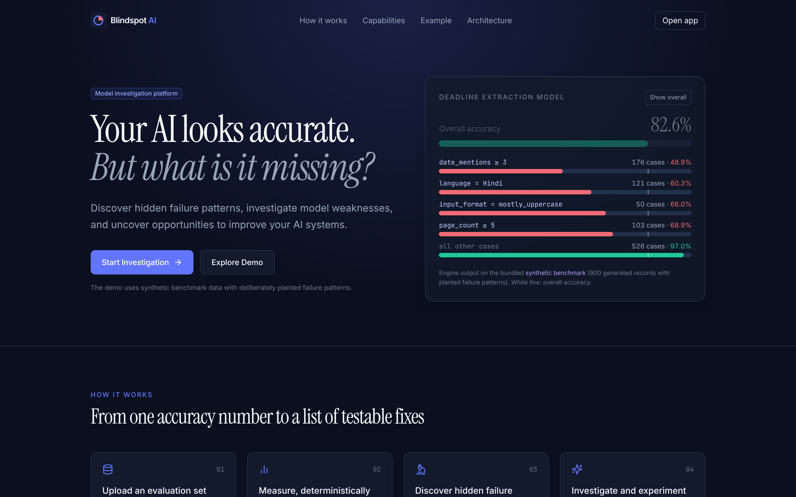
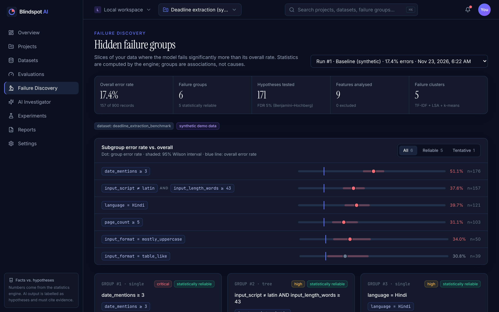
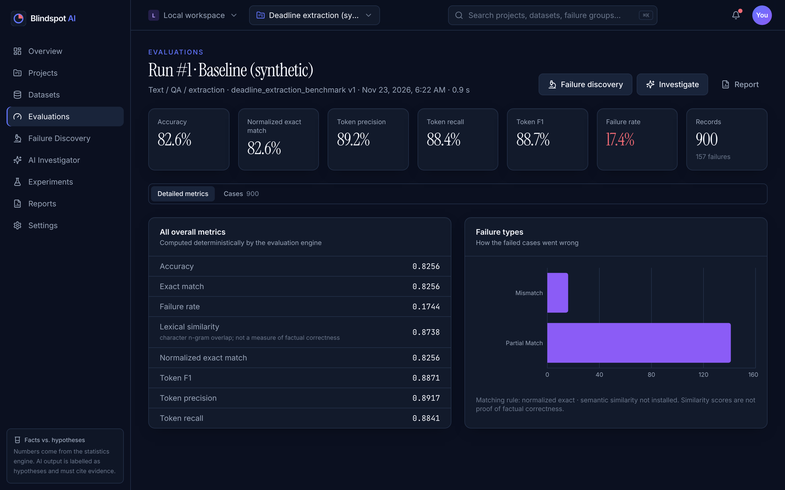

# Blindspot AI

**Your AI looks accurate. But what is it missing?**

Blindspot AI finds the hidden failure patterns behind a model's overall score. Upload an
evaluation set (inputs, expected outputs, the model's actual outputs, and any metadata). It
scores every case, finds the slices of your data where the model fails far more often than
average, groups similar mistakes, and helps you turn each weakness into a testable experiment.



## What it does

- **Deterministic evaluation** of classification, text / QA / extraction and structured JSON
  outputs. All metrics are computed in Python; no LLM is involved in scoring.
- **Hidden failure-group discovery.** Single conditions, two-condition rules and held-out
  decision-tree rules, with one Benjamini–Hochberg correction over the whole search, Wilson
  intervals, minimum group sizes, leakage checks and sequential covering, so every reported group
  explains failures the others do not.
- **Failure clustering** of similar mistakes (TF-IDF, LSA, k-means with silhouette-based choice
  of k).
- **Evidence-grounded AI investigator (optional).** Builds an evidence package with stable
  `EVIDENCE_###` ids, asks an LLM for hypotheses in a strict JSON schema, then removes invented
  evidence ids and flags unverified numbers and overclaiming. Statistics and hypotheses are
  always shown separately.
- **Experiment lab.** Track proposed fixes and measure them on a new evaluation run with a
  two-proportion test. No measured result means no claim.
- **Reports** as PDF, Markdown, JSON and CSV, stamped with run IDs and timestamps.
- **Synthetic benchmarks** with planted failure patterns, used both for the demo and to measure
  the engine.

| Failure discovery | Evaluation |
|---|---|
|  |  |

## Measured, not claimed

On the three bundled benchmarks the engine recovers **9 of 11** planted failure patterns. With
the failure labels randomly shuffled (nothing real to find), it raised a false alarm in **4 of 300**
runs (1.3%). Details, including the two misses and why they happen, are in
[docs/technical-evaluation.md](docs/technical-evaluation.md). Reproduce them with
`python scripts/run_benchmarks.py`.

## Quick start

```bash
cp .env.example .env      # optional: add OPENAI_API_KEY to enable the AI investigator
docker compose up --build
```

Open <http://localhost:8080> and choose **Explore Demo**. API docs are at
<http://localhost:8000/api/docs>.

Local development without Docker, free hosting on Render + Cloudflare, and how to run the
tests are covered in [docs/deployment.md](docs/deployment.md).

## Tech stack

- **Backend:** Python, FastAPI, SQLAlchemy 2, Alembic, PostgreSQL, pandas, NumPy, SciPy,
  scikit-learn, httpx, fpdf2
- **Frontend:** React 18, TypeScript, Vite, Tailwind CSS, Recharts, Lucide icons
- **Tests:** pytest (67 tests, runnable on SQLite or PostgreSQL), Vitest and Testing Library
- **Deployment:** Docker Compose; Render (API), any PostgreSQL such as Neon, and a Cloudflare Worker (website)

## Documentation

| | |
|---|---|
| [Demo walkthrough](docs/demo-walkthrough.md) | A guided tour of the deadline-extraction demo |
| [How the analysis works](docs/evaluation.md) | Metrics, features, search, statistics, clustering, investigator |
| [Architecture](docs/architecture.md) | Diagram, request flow, code layout, data model |
| [API reference](docs/api.md) | Every endpoint |
| [Technical evaluation](docs/technical-evaluation.md) | Benchmark recovery and false-alarm rates |
| [Limitations](docs/limitations.md) | What the results can and cannot tell you |
| [Deployment](docs/deployment.md) | Docker, local setup, Render + Cloudflare, tests |
| [Sample report](docs/samples/deadline-investigation-report.md) | A real export from the demo |

## Your data

Uploaded files stay in your own database and storage. Nothing is sent to an LLM unless you add
an API key **and** turn on AI investigation for a project; even then only the evidence package
(statistics and a few dozen excerpts) is sent. The demo datasets are synthetic and are labelled
as such everywhere.
