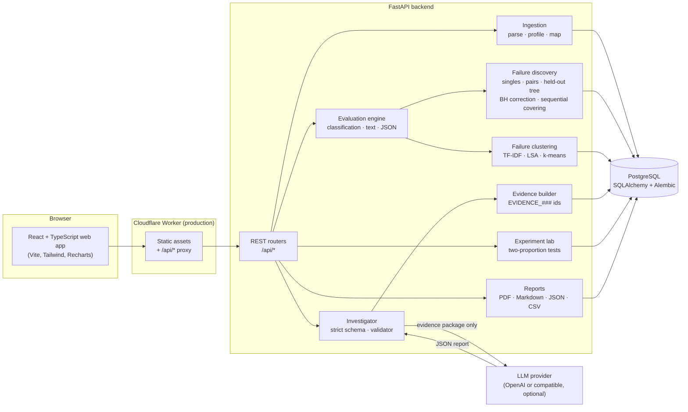

# Architecture

Blindspot AI is split into a deterministic analysis core and an optional AI layer. Every number
shown to a user comes from the core. The AI layer can only read numbers and records the core
has already produced, and its output is checked against them before it is saved.



In local development and Docker, the Vite dev server or nginx plays the role of the worker and
forwards `/api/*` to the backend, so the browser always talks to a single origin.

## Request flow for one analysis

1. **Upload** (`POST /api/datasets/upload`). The file is parsed safely: size and row limits,
   binary detection, a column-count limit, and CSV / JSON / JSONL errors with line numbers. The
   parsed rows are stored in PostgreSQL. The original file is kept on disk for provenance, along
   with its SHA-256 hash and a version number.
2. **Map columns** (`PUT /api/datasets/{id}/mapping`). The user says which columns hold the input,
   the expected output, the actual output, the case ID and metadata. The server checks the rows,
   drops metadata columns that are copies of the outputs (leakage), and suggests a task type.
3. **Evaluate** (`POST /api/evaluations/run`). Each case is scored in Python
   (`app/evaluation`). There is no LLM in this step. Then failure discovery
   (`app/failure_discovery`) and clustering (`app/clustering`) run on the per-case results and
   are stored with the run.
4. **Investigate** (`POST /api/investigations/run`, optional). The evidence builder
   (`app/evidence`) assembles a fixed package: the verified statistics, representative failures,
   correct cases from the same group, similar failures outside it, and clusters. Each item gets an
   `EVIDENCE_###` id. Only this package is sent to the LLM. The reply must match a strict
   Pydantic schema. The validator then removes references to ids that do not exist, flags
   hypotheses without support, and flags numbers that do not appear in the package.
5. **Experiment** (`/api/experiments`). Hypotheses become experiments. An experiment is
   measured by re-applying the failure group's rule to a new evaluation run and comparing error
   rates with a two-proportion test.
6. **Report** (`GET /api/reports/{run_id}`). The same data, exported as PDF, Markdown, JSON or
   CSV, stamped with the run ID and timestamps.

## Code layout

```
backend/
  app/
    api/                 FastAPI routers (one file per resource) and shared dependencies
    core/                settings, error types, logging
    database/            engine and session setup (numpy-safe on PostgreSQL)
    models/              SQLAlchemy models
    schemas/             request and response models
    evaluation/          deterministic metrics: classification, text, JSON
    failure_discovery/   features, statistics, subgroup search and selection
    clustering/          failure clustering by "mistake signature"
    evidence/            retrieval index and evidence-package builder
    investigator/        provider client, strict schemas, validation, orchestration
    experiments/         experiment lifecycle and measurement
    services/            use-case services (datasets, evaluations, reports, demo data...)
    demo/                seeded synthetic benchmark generators and recovery scoring
    prompts/             investigator prompt templates
  migrations/            Alembic migrations
  tests/                 unit, integration and benchmark tests
frontend/
  src/pages/             one file per page
  src/components/        UI kit, domain components, charts
  src/hooks/ services/   data fetching and API client
  worker.ts              Cloudflare Worker (production)
scripts/                 benchmark and dataset generation scripts
```

## Data model

`Project` → `Dataset` (versioned) → `EvaluationRun` → `FailureGroup` (+ examples), `Cluster`,
`EvaluationMetric`. An `Investigation` belongs to a run and holds `InvestigationHypothesis` and
`EvidenceItem` rows. An `Experiment` belongs to a project, optionally points at a failure
group and a hypothesis, and holds `ExperimentResult` rows. `ActivityEvent` feeds the activity
log. Deleting a project cascades to everything under it.
