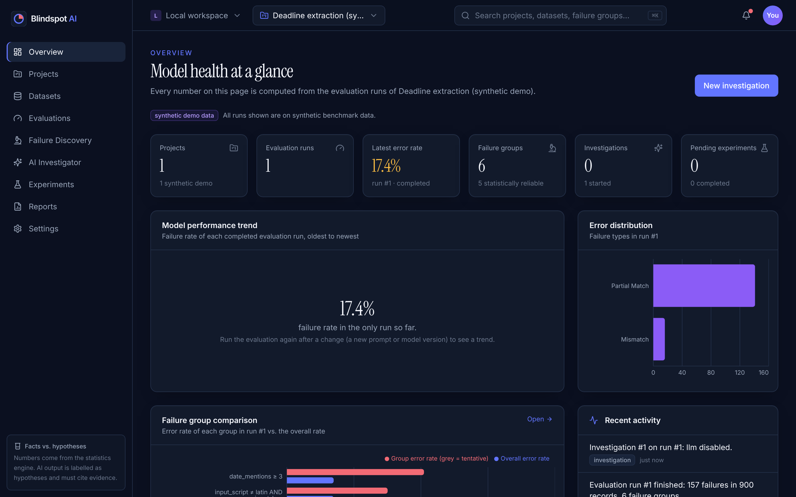
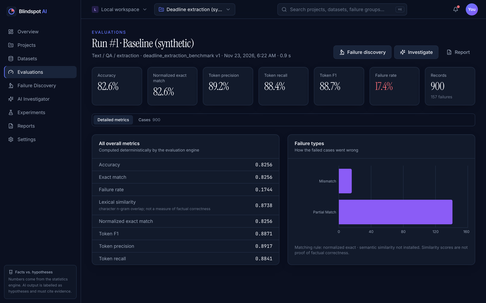
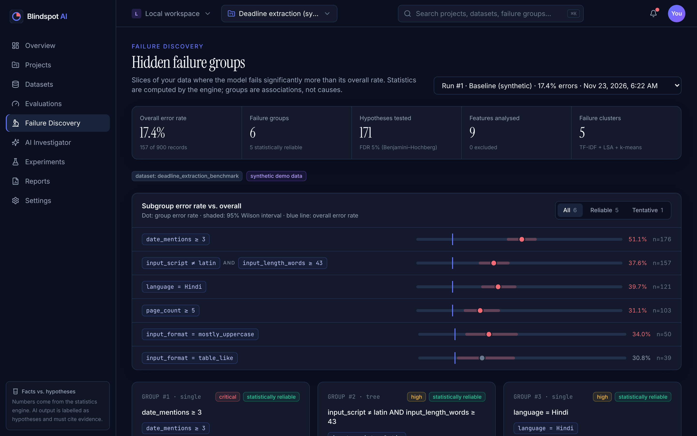
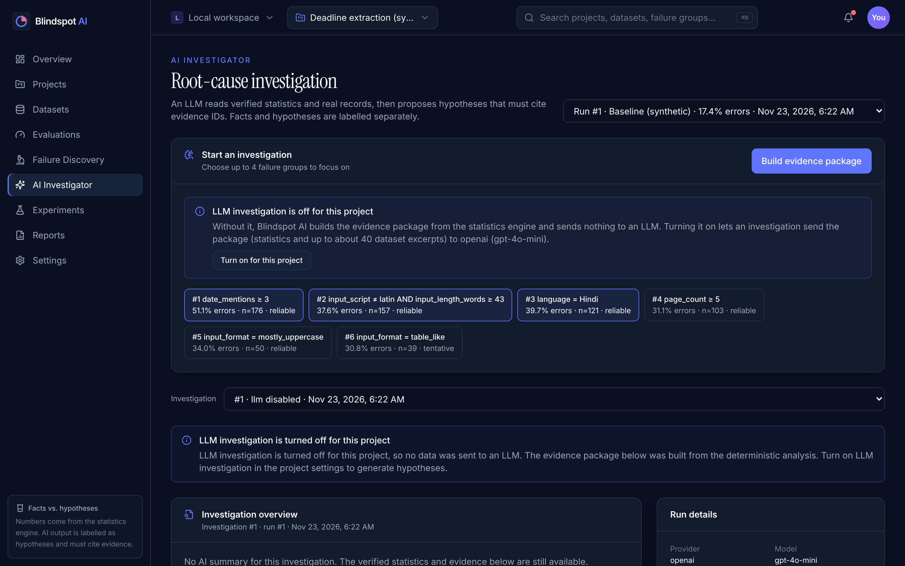
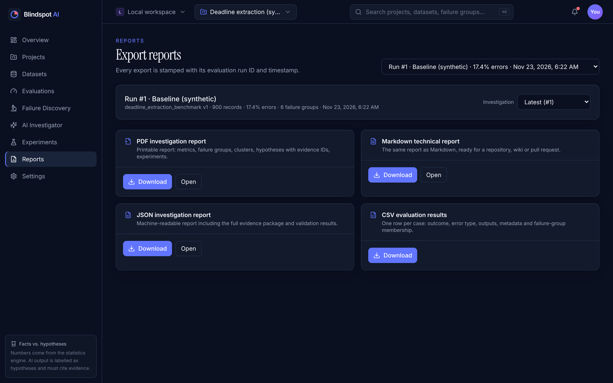

# Demo walkthrough

This walkthrough uses the bundled **deadline extraction** demo: 900 synthetic notices from which
a simulated model extracts the application deadline. Its overall accuracy is 82.6%, which looks
fine. Five weaknesses were planted in the data on purpose. Here is how Blindspot AI finds them.
Every number below is what the app shows for this demo.

## 1. Load the demo

On the landing page choose **Explore Demo**, or in the app open **Projects** and load the
deadline extraction demo. The project, dataset, column mapping and a first evaluation run are
created in a few seconds. Everything that comes from the demo is marked *synthetic demo data*.

## 2. Read the evaluation

**Evaluations → Run #1** shows the metrics computed in Python: accuracy and normalized exact
match 82.6%, token F1 88.7%, failure rate 17.4% (157 of 900). The failure types show most
failures are partial matches: the model picked a date, just not the right one. The **Cases** tab
lets you read every case with its input, expected and actual output.

## 3. Find the hidden failure groups

**Failure Discovery** tested 171 rules and corrected for all of them together. Five groups are
statistically reliable:

| Group | Error rate | Records | Planted pattern it matches |
|---|---:|---:|---|
| `date_mentions ≥ 3` | 51.1% | 176 | notices with several dates |
| `input_script ≠ latin AND input_length_words ≥ 43` | 37.6% | 157 | long non-latin notices (partly mixed-language) |
| `language = Hindi` | 39.7% | 121 | Hindi notices |
| `page_count ≥ 5` | 31.1% | 103 | long documents |
| `input_format = mostly_uppercase` | 34.0% | 50 | unusually formatted notices |

A sixth candidate, `input_format = table_like` (30.8%, 39 records), is shown as **tentative**:
it is not significant after correction (q = 0.20), so it is a lead to check, not a finding.

Each group shows its 95% interval, q-value, how many extra failures it explains, and notes such
as "Still elevated after removing higher-ranked groups". Below the groups, failure clusters group
similar mistakes, for example "prediction not found in the input".

## 4. Investigate

**AI Investigator → Build evidence package** collects 30 evidence items with stable ids: the
verified statistics of the chosen groups, representative failures, correct cases with the same
rule, and similar failures outside each group.

With an OpenAI key configured and AI investigation turned on for the project, the same button
sends only this package to the model. The reply must follow a strict schema, cite `EVIDENCE_###`
ids, list counter-evidence, and propose experiments. Invented ids and unverified numbers are
removed or flagged. Without a key (as in these screenshots) you get the package and the verified
facts, and nothing is sent anywhere.

## 5. Turn hypotheses into experiments

In **Experiments**, each recommended experiment names the target group, the proposed change, how
to test it and what counts as success. After you change the model or prompt, upload the new
outputs as a new dataset version, run the evaluation, and choose **Measure**. Blindspot AI
re-applies the group's rule to the new run and tests whether the group's error rate really
changed. Until then the experiment makes no claim.

## 6. Export

**Reports** exports the run as a PDF or Markdown report, as JSON with the full evidence
package, or as a per-case CSV. Every export is stamped with the run ID and timestamps. A real
example: [samples/deadline-investigation-report.md](samples/deadline-investigation-report.md)
([PDF](samples/deadline-investigation-report.pdf)).

## Try your own data

Use **New investigation** and upload a CSV, JSON or JSONL file with at least an expected output
column and an actual output column. Add metadata columns (language, source, document type,
customer segment...) to give failure discovery something to work with.
`datasets/sample/quickstart_example.csv` shows the expected shape.
